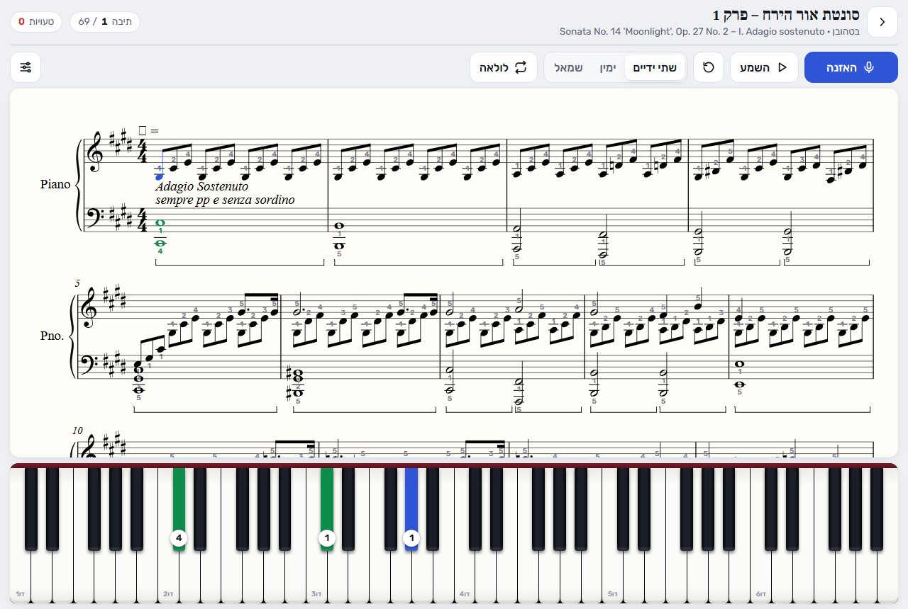
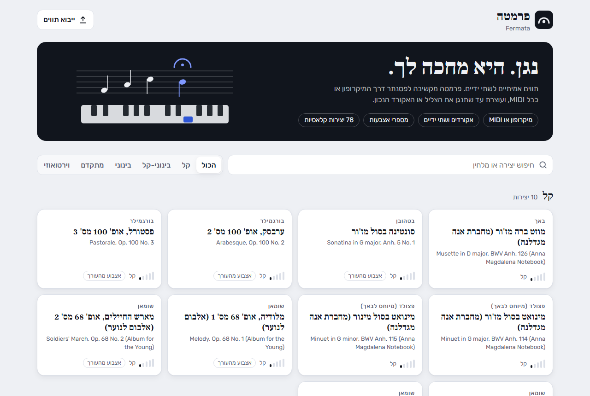
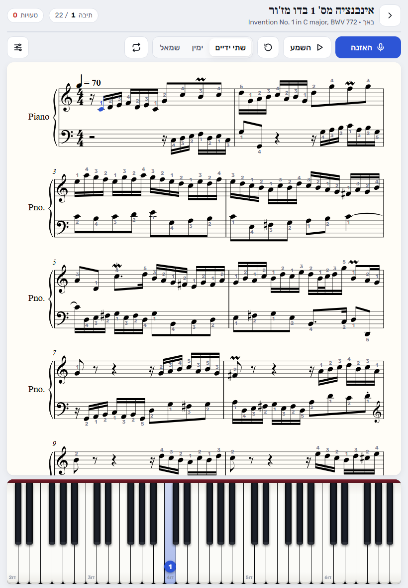

<div align="center">

# 𝄐 Fermata · פרמטה

**A free piano practice app that listens to you and waits until you play the right notes.**

Real sheet music, both hands, chords. Runs in the browser on a tablet, phone or computer.

**[▶ Open Fermata](https://oribraverman.github.io/fermata/)**



</div>

<div dir="rtl">

### בעברית

פרמטה היא אפליקציית תרגול פסנתר חינמית שעובדת בדפדפן, גם בטאבלט. היא מציגה תווים אמיתיים לשתי הידיים, מקשיבה לפסנתר שלך דרך המיקרופון או כבל MIDI, ומחכה עד שתנגן את הצליל או האקורד הנכון. על המקלדת שבמסך מסומנים הקלידים הבאים, כל אחד עם מספר האצבע המומלצת. בספרייה 78 יצירות קלאסיות, מסונטינות ועד שופן וליסט, ואפשר גם לייבא קבצים משלך.

</div>

## What it does

- **Wait mode, with chords.** The score stops at every note or chord until you play all of it, then moves on.
- **Listens to an acoustic piano** through the device microphone, or reads a digital piano over **MIDI** (Chrome, Edge, Android). You can also tap the on-screen keys.
- **Real notation** for both staves (rendered with [Verovio](https://www.verovio.org)). The current notes are highlighted, and the page turns by itself.
- **Fingering everywhere.** It shows the editor's fingering when the score has it, and works out a fingering when it doesn't.
- **Practice tools:** hands separately (the other hand plays along), loop any range of bars, listen to a passage at any speed on a sampled concert grand, and tap any note in the score to start there.
- **78 pieces built in**, from easy to virtuoso: Bach, Mozart, Beethoven, Schubert, Chopin, Schumann, Liszt, Grieg, Debussy, Satie, Joplin and more.
- **Bring your own scores:** MusicXML (`.musicxml`, `.mxl`, e.g. exported from MuseScore), Humdrum (`.krn`), MEI or ABC. Imported files stay in your browser.
- Remembers where you stopped in each piece. Each piece has its own link, e.g. [`#chopin-prelude-4`](https://oribraverman.github.io/fermata/#chopin-prelude-4).

<table><tr>
<td></td>
<td></td>
</tr></table>

## Getting started

1. Open **[oribraverman.github.io/fermata](https://oribraverman.github.io/fermata/)** on the device next to your piano. On a tablet, *Add to Home Screen* makes it feel like an app.
2. Pick a piece and press **האזנה** (Listen). Allow microphone access.
3. Play the highlighted keys. Blue is the right hand and green is the left, and the number on each key is the finger to use.

If notes aren't picked up, raise **רגישות** (sensitivity) in settings ⚙. If it reacts to noise, lower it. A digital piano connected by USB/MIDI is detected automatically and is always exact.

## How the listening works

Recognising several notes at once from a microphone is hard in general. Fermata makes it tractable by using what it already knows: **the notes you are supposed to play next**.

Every 25 ms it takes an 8192-point FFT of the microphone signal and computes a *salience* for each of the 88 keys: a weighted sum of the spectrum at that key's first 16 harmonics, allowing for piano-string inharmonicity. Partials too close together to tell neighbouring keys apart are down-weighted.

A key counts as **struck** when either:
- it becomes a spectral peak, louder than both semitone neighbours and well above the noise floor; or
- it was already sounding and jumps again together with a broadband attack (a repeated note).

For the keys the score expects, the check is score-informed. A key's neighbours are judged only on partials that the other notes of the chord can't explain, so D3 + F4 sounding together don't mask A3 through the "missing fundamental" B♭. A wait-mode judge accepts the step once every expected key has been struck within 400 ms. Notes played slightly ahead are kept for the next step, so fast passages don't get stuck.

The detector was tuned against real Salamander grand-piano recordings, rendered with room reverb and noise (`test/harness.html`). Triads in both hands, repeated notes and chords, a melody over a held bass, and a noisy, reverberant room are all recognised, and wrong chords are rejected.

**Known limits:** fast chromatic runs low in the bass sometimes need a note played twice. Rarely, a note that is an overtone of a bass note still ringing (E3 right after A2) is accepted a moment early. A MIDI connection has neither problem.

## Under the hood

Plain HTML/JS modules with no build step. Verovio and the piano samples load from CDNs.

| File | |
|---|---|
| `index.html` | the app shell and styles |
| `js/app.js` | library, practice screen, wait-mode flow, playback, settings |
| `js/engine.js` | FFT, harmonic salience, onset detector, wait-mode judge |
| `js/score.js` | score → practice steps via Verovio's timemap and MEI (pitches, ties, grace notes, 8va lines, fingering, bars) |
| `js/fingering.js` | automatic fingering: dynamic programming over a Parncutt-style hand-span cost model |
| `js/audio.js` | sampled grand piano, microphone capture, Web MIDI |
| `library/` | the 78 pieces plus `catalog.json` (titles in Hebrew and English, level, source, licence) |

### Run locally

Any static server works. The microphone needs `localhost` or https.

```bash
npx serve .
```

### Tests

```bash
node test/fingering.test.mjs
```

```bash
npm i --prefix /tmp/vrv verovio@6.3.0
VEROVIO_DIR=/tmp/vrv node test/score.test.mjs
VEROVIO_DIR=/tmp/vrv node test/library.test.mjs
```

`library.test.mjs` loads every piece and checks the fast pitch extraction against Verovio's own MIDI output (18,000+ notes, 0 mismatches). The automatic fingering is checked against standard fingerings for scales, five-finger positions, triads and octaves. Open `test/harness.html` through a local server to run the microphone detector on rendered piano audio.

## Credits and licences

- **Scores:** 59 pieces are CC0 or public domain, from the [PDMX](https://zenodo.org/records/13763756) dataset of MuseScore public-domain scores. 12 are CC BY-NC-SA 4.0, from the [ASAP](https://github.com/fosfrancesco/asap-dataset) dataset. 7 Humdrum files are CC BY-NC-SA 4.0 from [Craig Sapp](https://github.com/craigsapp)'s repositories. The exact source and licence of every piece are in `library/catalog.json` and shown in the app.
- **Piano sound:** Salamander Grand Piano by Alexander Holm, CC BY 3.0, served by [Tone.js](https://tonejs.github.io/).
- **Notation engraving:** [Verovio](https://www.verovio.org) (LGPL-3.0).
- **Fonts:** Rubik and Frank Ruhl Libre (SIL OFL), via Google Fonts.
